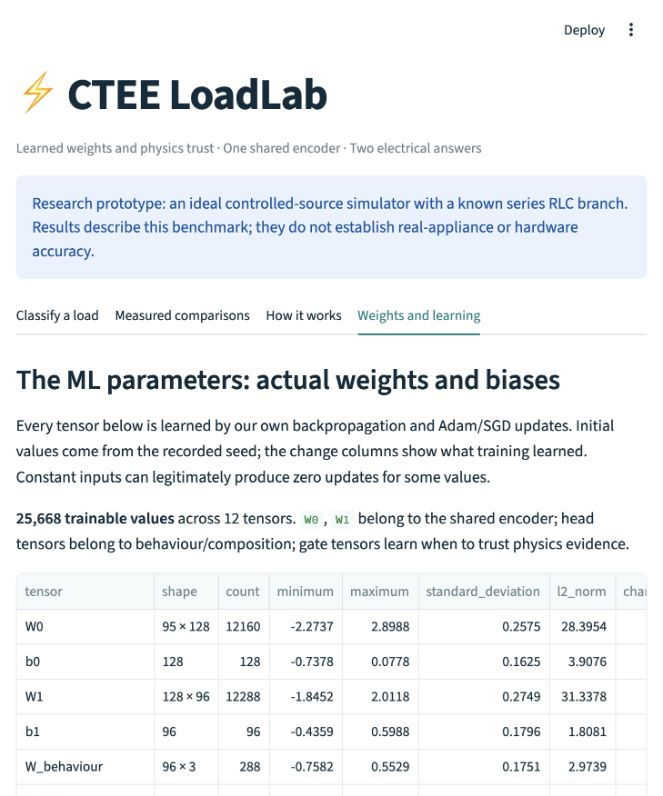

# Explain and defend this project

## The 30-second explanation

We give the computer recordings of voltage and current. It answers two questions together: **how does the load respond when voltage changes, and which resistance/inductance/capacitance branch does it resemble?** One shared neural network learns useful patterns, then two output heads give the two answers.

Our enhancement adds electrical clues, checks confidence, and chooses another simulated measurement when the current evidence is insufficient. It can say **inconclusive** instead of confidently guessing. We wrote the calculations and learning steps ourselves with NumPy. The model has 25,668 trainable weights/biases, including gates that learn how much to trust electrical evidence. We can inspect every value and show how it changed during training.

## What CC, CP and CZ mean

| Behaviour | If voltage falls slightly | Simple interpretation |
|---|---|---|
| CC: constant current | Current stays approximately constant | The controller holds current steady |
| CP: constant active power | Current rises, under the stated fixed-PF conditions | The controller tries to keep power steady |
| CZ: constant impedance | Current falls with voltage | A fixed passive circuit at a fixed frequency |

A single ordinary voltage recording can make these cases look alike. We need more than one settled voltage level. The current-response slope is approximately 0 for CC, −1 for CP and +1 for CZ. CP is also verified from active power, not assumed from its name.

## What the second answer means

R dissipates energy. L stores energy magnetically. C stores energy electrically. Combinations create different phase, frequency and startup patterns. A single-frequency impedance does not identify arbitrary hidden circuitry. Our labels refer to a **declared series branch in a controlled-source simulator**, not the full internals of every appliance.

There are 18 supported pairs: seven CC, seven CZ and four CP. CP requires R/RL/RC/RLC in this benchmark. We did not create invalid labels simply to fill all 21 cells.

## What happens inside the program

1. Simulate a physical branch and its allowed operating modes. Keep all versions of that branch in one train/validation/calibration/test split.
2. Measure voltage/current under nominal voltage, small voltage changes, harmonic excitation and a frequency probe. Startup is optional.
3. Compute 95 clues, including RMS, power, phase, normalized reactive power, impedance, harmonics, voltage-response slopes, FFT descriptors, startup shape and availability masks.
4. Standardize using training records only. The shared encoder transforms the clues into a 64-number learned representation.
5. One head outputs three behaviour scores; the other outputs seven composition scores. Softmax turns each head's scores into probabilities.
6. During training, compare predictions with known simulator labels. Differentiate both losses by hand, add their gradients in the shared layers, and update weights with manual Adam.
7. Add measured electrical priors, head-specific learned quality gates and a masked slope-consistency term. Optionally average recent trained weights and keep the best raw/averaged checkpoint by validation loss. Only available measurements supply these terms.
8. Calibrate probabilities/thresholds on separate calibration circuits. Accept only if voltage span, spectral evidence, fit quality, signal quality and confidence pass.
9. Request another simulated probe if needed, or stop and show the two tentative answers as inconclusive.

## Why use two heads?

Both questions depend on many of the same electrical measurements. Sharing lets both tasks train the same encoder. The gradients from both heads add before updating it. We verified that gradient addition numerically. We have not established that sharing beats separately trained single-task models, because that comparator is not included in this run.

## What is proposed as new?

Our defensible contribution is the **tested combination of electrical fingerprints, dual-target learning, electrical consistency, calibrated rejection and adaptive measurement for this scoped task**. The contribution is supported by comparisons and measurement-budget curves.

Do not claim that neural networks, Hilbert transforms, FFT, attention, physics losses, temperature scaling or active probing were invented here. The supplied papers are related appliance-identification research; their datasets/labels differ. Their scores cannot be put beside ours as if these were the same test. A worldwide novelty claim needs a broader literature review.

## What did we achieve?

- Validation-selected gated model, held-out joint accuracy: **100% clean, 99.26% at 20 dB white noise**. Matching baseline: **98.15%, 97.78%**.
- Across three seeds, 20 dB gated-model mean: **99.38%**, baseline mean **97.78%**. The ordinary baseline is stronger under sensor shift; no model wins every condition.
- Frozen-model confirmation on **700 new circuits / 1,800 episodes per condition**: **97.89% at 20 dB**, baseline **97.78%**. The difference is statistically inconclusive. Do not hide this larger-pool result behind the smaller test's 99.26%.
- For the same frozen neural weights, learned gates give **99.26%** at 20 dB versus **98.15%** with gates fixed to 0.5. Under coloured noise, the comparison is **80.00% vs 75.56%**. Sensor shift is a counterexample where the learned gates hurt that control.
- Mean composition physics trust falls from **0.850 clean to 0.547 in severe coloured noise**, learned from measured indicators rather than true component values.
- Adaptive acquisition saves **19.3%** of probes versus fixed-order early stopping, but accepted accuracy falls from **98.62% to 96.33%**, at **80.74% coverage**. Full five-probe measurement is the default.
- Severe coloured noise remains a failure condition. Its recordings are rejected; zero coverage is not perfect classification. Calibration worsens test composition NLL/Brier in this run; it is not claimed as a successful enhancement.
- All **78 tests pass** in an environment without PyTorch, SciPy, scikit-learn or joblib.

See `../RESULTS_NUMPY.md` for confidence intervals, failure classes and all comparison details.

## What should I say about statistics?

F1 balances precision/recall for each class; macro-F1 averages classes equally. AUC measures probability ranking across thresholds. Joint accuracy counts an example as correct only when **both labels match**. NLL/Brier/ECE assess confidence. Brier skill compares probabilities with a training-prevalence reference. Z-score standardization is preprocessing, not a classification score.

MAE/MSE/RMSE/R²/RPD apply to a continuous quantity: here, the measured voltage-response slope versus its known theoretical value. Integer class labels have no meaningful numerical distance. MAPE is invalid for the zero CC slope. RMSE is not itself a universal proof of convergence; we inspect validation loss and restore its best checkpoint.

ANOVA/Friedman compare several frozen models on disjoint device panels. A significant omnibus test means at least one model differs, not that our model beats all others. The enhanced-versus-baseline panel comparison is not significant after multiplicity correction. The 20 dB physical-device bootstrap intervals also include zero in both the main test and fresh pool. Report uncertainty; universal improvement is not established.

## How can I tinker with it?

Change one hyperparameter family at a time in `configs/gated_experiments.json`, then use a new output folder. Useful controls are learning rate, widths, dropout, batch size, activation, initialization, optimizer moments, clipping, prior strength and consistency weight. Record validation performance, runtime and uncertainty as well as accuracy. Keep noise/measurement budgets equal across comparisons. Do not repeatedly choose settings based on the final test score.

## What remains for a stronger research project?

Independent circuit-simulator/hardware checks, realistic converter controllers, wider operating ranges, real measurements with verified dual labels, stronger sensor-shift training, a penalty-only ablation and single-task comparators. If further improvements are developed after seeing these tests, use genuinely new final confirmation circuits. A high synthetic score alone cannot establish the world's best classifier or guarantee a grade.

## The professor asks: “Do you control the weights or just library settings?”

“Yes. Every forward calculation, derivative, optimizer moment and update is in our own NumPy code. The selected model has 25,668 trainable values; 25,666 changed beyond 1e-12 during this run. Two gate coefficients multiply a constant standardized input and remain zero. I can download every initialized/learned value, inspect the gradient/update curves, or change one value in a sandbox and see its effect. Learning rates and widths are hyperparameters; the weight arrays themselves are the learned parameters.”

The new quality-conditioned trust mechanism and its equations are explained in `WEIGHTS_AND_NOVELTY.md`. Learned gates and weight averaging have prior work, so describe our project-specific mechanism and experiments without claiming those general ideas were invented here.

## The parameter inspector in the running dashboard

