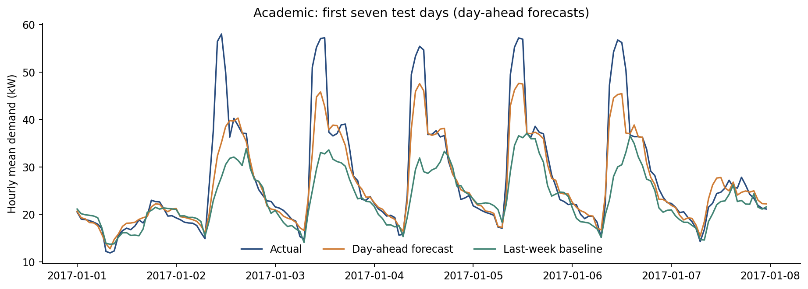
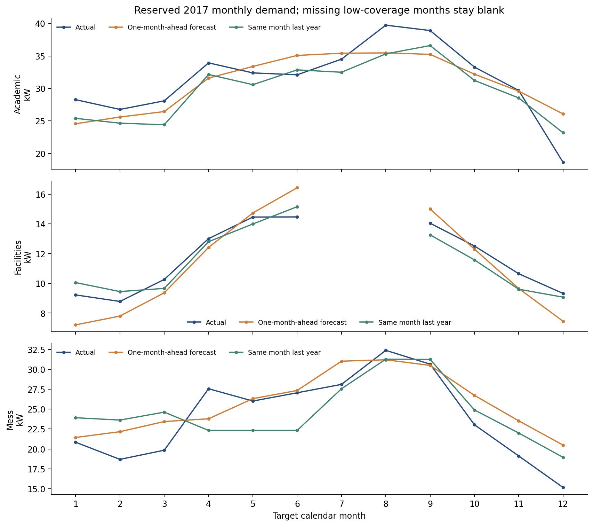
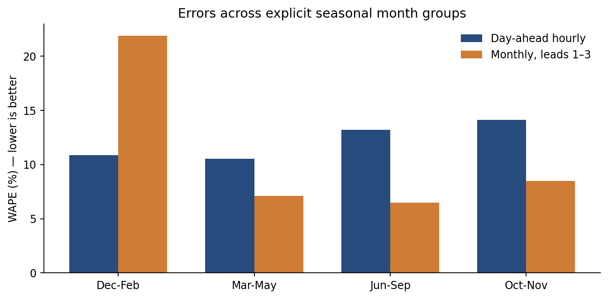
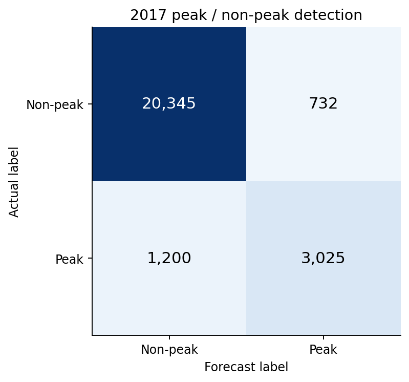
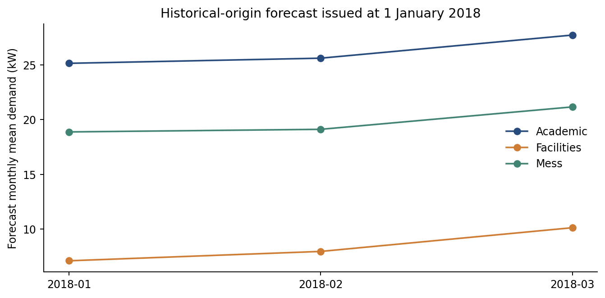
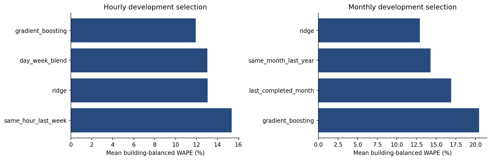

# Model 3: seasonal demand forecasting and peak periods

This is the corrected task requested on 27 November 2026. Earlier building-recognition and circuit-feasibility artifacts are historical work; they are not the forecasts reported here.

## What the revised system predicts

For each known building (Academic, Facilities, Mess), it predicts **24 hourly average loads for the next day**, and the **average load in each of the next three months**. It flags a forecast hour as peak when forecast demand exceeds that building's historical 90th percentile. This is a data-defined high-demand rule, not a supplied tariff schedule, instantaneous surge threshold or equipment capacity limit. It does not assign R/I/RC/RLC circuit labels.

All forecasts are in kW, a measure of power. Monthly average kW is not monthly energy in kWh. Hourly averages can hide short minute-level spikes. A day-ahead forecast is issued at local midnight after the previous day's readings have arrived. A monthly forecast is issued at the start of a month after the preceding month has ended. These availability assumptions are explicit.

## Data and quality

The same user-supplied ZIP contains 6,331,530 minute measurements from three campus buildings, spanning 2013–2017. Unix seconds are converted to Asia/Kolkata before local-hour aggregation. Availability flags mask absent power readings. Invalid, nonfinite or negative power becomes missing. An hour needs at least 48 valid minutes (80%); a monthly target needs at least 80% of all expected hours. Missing targets are excluded rather than filled. Missing past inputs use a median learned only on the training period. Real zeros are retained. Current, voltage and power factor are unnecessary for the demand targets and are not predictors.

The source labels identify buildings and availability, not peak status or seasons. The four seasonal groups are explicitly defined as Dec–Feb, Mar–May, Jun–Sep and Oct–Nov; these are calendar groups rather than measured weather labels. Holidays/activity files are excluded because their advance publication is not documented. No weather forecasts were supplied.

## Features and model choice

The day-ahead model uses 20 inputs: matching hourly loads 1, 2, 7 and 14 days earlier; summaries of the last completed day; preceding 7/28-day daily means; cyclic hour, weekday and annual calendar variables; weekend status; and building indicators. It never uses actual demand from the day it is forecasting. Building identity is a legitimate known input for this demand forecast.

The monthly model uses 11 inputs: completed-month loads, the previous three-month average, the same target month last year, target-month seasonality, forecast horizon and known building. Longer-horizon targets from the same origin share the same completed historical months; actual intermediate future months are not injected. No forward interpolation or centered rolling windows are used.

The selected hourly model is **gradient_boosting**, a gradient-boosted tree regressor that combines small decision trees to predict load. The selected monthly model is **ridge**, ridge regression, which estimates a regularized relationship between past loads, seasonality and the future monthly mean. Each was compared against history-based baselines and the other learned model. Selection minimized mean validation WAPE equally weighted across the three buildings, so the largest building did not dominate selection. Settings were fixed before evaluating 2017. Negative predictions are clipped to zero, a predeclared physical bound.

## Chronological evaluation and leakage controls

Development validation blocks were 2015, January–June 2016 and July–December 2016, always trained on earlier completed targets. The final evaluation models were fitted using targets completed before **1 January 2017** and then frozen. All buildings share the same calendar boundaries. Every monthly training target must have finished before a validation/test origin, including the third-month horizon; boundary-crossing training labels are purged. The first 14 days of each hourly series and the first 12 calendar months of each monthly series provide historical context rather than evaluation samples.

Evaluation is rolling-origin: at each later midnight or month-start, historical observations already available at that origin may update the input features. Fitted evaluation model parameters never retrain during 2017. This is not a single forecast of all 2017 issued at the start of that year. The monthly test has **93 origin/building/horizon forecast records** covering **34 distinct building-month targets**; repeated target months at different horizons are not independent observations. There are **25,302 eligible building-hours** in the hourly test, out of 26,280 possible 2017 building-hours. Exclusions and split manifests are saved.

The ZIP and some 2017 data had already been inspected for the abandoned building-recognition experiment. Consequently this is a retrospective forecasting holdout, not a claim that 2017 had never been seen in any context. No 2017 forecasting scores were used for selection or post-test tuning. More recent unseen data would provide stronger external validation.

## Final 2017 results

| Forecast | MAE (kW) | RMSE (kW) | WAPE | Baseline MAE (kW) |
| --- | ---: | ---: | ---: | ---: |
| Next-day hourly | 2.749 | 4.578 | 12.19% | 3.546 |
| Monthly, horizons 1–3 | 2.127 | 2.960 | 9.10% | 2.134 |

MAE means average absolute difference between predicted and actual load. For example, 2.75 kW MAE means forecasts were about 2.75 kW away from the actual hourly load on average. WAPE is sum of absolute errors divided by sum of actual load across the scored observations. It is an error measure, not classification accuracy; **12.19% WAPE must not be presented as 87.81% accuracy**. R² is 0.8765 for hourly forecasts and 0.8964 for monthly forecasts.

The hourly baseline repeats the same hour one week earlier. The monthly baseline repeats the same month one year earlier. Missing baseline history falls back to that building's training median. Hourly MAE improves by 22.48%. Monthly MAE improves by only 0.30%; that is effectively tied overall, and the baseline has a lower monthly RMSE (2.661 versus 2.960 kW). The monthly model must not be claimed to strongly outperform a seasonal baseline. Seasonal Dec–Feb monthly WAPE is 21.86%, showing that error varies substantially by season.

## Peak / non-peak evaluation

Peak thresholds fitted before 2017: Academic **49.38 kW**, Facilities **15.04 kW**, Mess **32.45 kW**. Peak flags are derived from the predicted demand; there is no independent classifier with inconsistent load and peak outputs. The 90th percentile is an explicit assumption because no professor-specified limit was supplied.

Accuracy: **92.36%**. Peak precision: **80.52%**. Peak recall: **71.60%**. Peak F1: **0.7580**. Macro F1: **0.8563**. The system missed **1,200 of 4,225 actual peak hours** and raised **732 false peak flags**. Predicting every hour as non-peak would already achieve 83.30% accuracy, so recall and precision are essential alongside accuracy. The last-week baseline's peak F1 is 0.7139.

## Issued forecasts and their date

After freezing the evaluation results, separate operational versions were fitted on all eligible data through December 2017. These produce 72 hourly forecasts for **1 January 2018** and nine building-month forecasts for **January–March 2018**. Operational peak thresholds are recalculated using history through 2017 and saved separately from the evaluation thresholds. These forecasts are examples from the dataset's historical endpoint, **not forecasts for 2026**. Their future actual loads were not supplied, so no observed accuracy or predictive interval is claimed for them. The evaluated models and operational refits are separately named and serialized.

| Building | Jan 2018 average kW | Feb 2018 average kW | Mar 2018 average kW |
| --- | ---: | ---: | ---: |
| Academic | 25.15 | 25.62 | 27.74 |
| Facilities | 7.10 | 7.96 | 10.12 |
| Mess | 18.88 | 19.12 | 21.17 |

For 1 January 2018, all 72 hourly forecasts are below their historical high-demand cutoffs, so all are classified non-peak. This does not mean the load is constant: the highest predicted hourly average within each day is still identifiable. It is a different meaning of “daily maximum” from exceeding a fixed historical peak threshold.

| Building | Highest forecast hour (local) | Highest hourly mean (kW) | Historical peak cutoff (kW) |
| --- | --- | ---: | ---: |
| Academic | 2018-01-01 12:00 | 28.40 | 50.88 |
| Facilities | 2018-01-01 18:00 | 11.27 | 15.59 |
| Mess | 2018-01-01 13:00 | 22.74 | 33.78 |

## Figures and professor explanation

“My revised Model 3 forecasts how much electricity each building will use tomorrow and over the next three months. It learns daily, weekly and yearly patterns from past power readings. It flags high-demand hours using a threshold defined from training history. I tested the forecasts on later dates, compared them with simple seasonal baselines, and reported forecast errors and missed peak hours.”

The main limits are three known meters at one campus, a short monthly history, missing measurement periods, no weather inputs, calendar-derived peak/season rules and changing operations. The model has not been shown to generalize to new buildings. Recent data is needed to make current forecasts. No claim is made about physical circuit types, utility tariff peak schedules, instantaneous safety limits or guaranteed detection of every peak. Saved checks verify causal feature construction by changing future data and checking that earlier forecasts' inputs do not change.

All test predictions, issued forecasts, quality records, split manifests, model-selection scores and chart source tables are saved in results/. Compressed CSVs can be opened with pandas directly or decompressed before loading in Excel. forecast_results.xlsx includes both prediction tables and all data behind its editable charts. Six causal-feature/metric tests and saved-model verification accompany this experiment.
