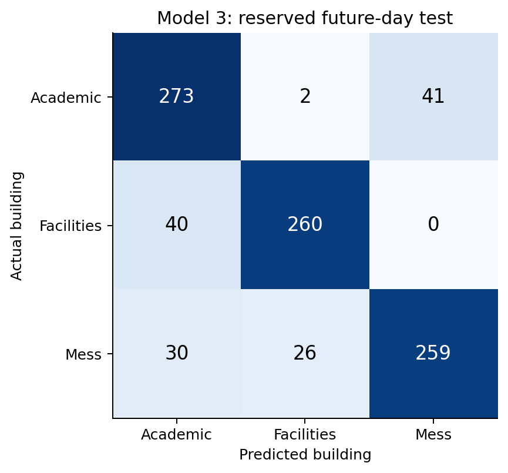
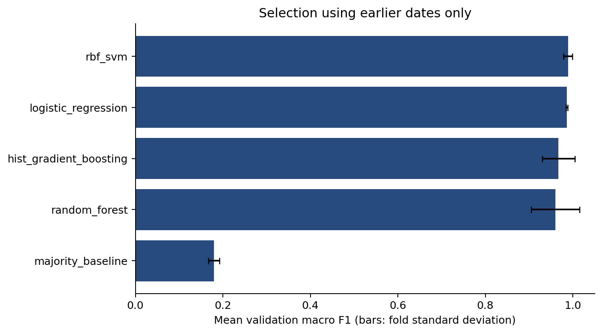
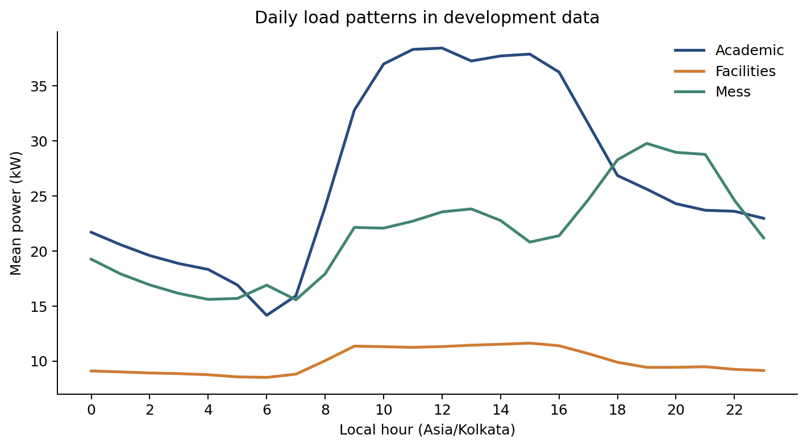
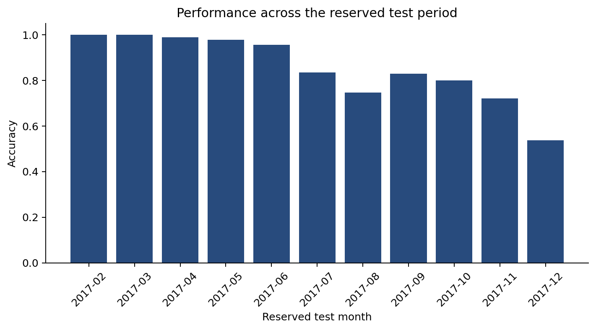
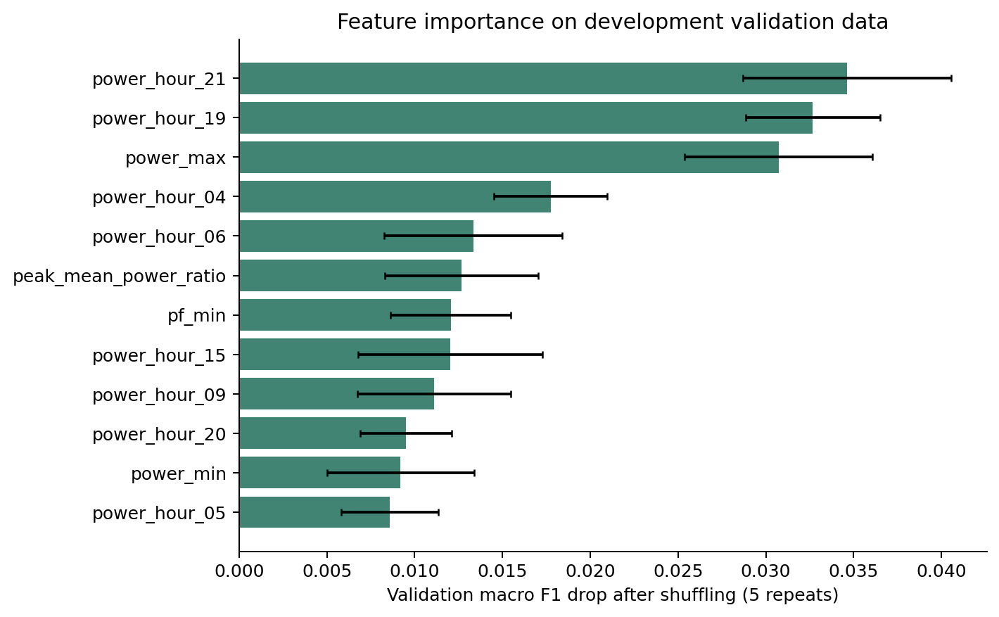

# Model 3: Khusboo building load-profile classifier

## The question this model answers

Given one completed day's electrical measurements, did it come from the **Academic**, **Facilities**, or **Mess** building in this dataset? These labels come from the three source filenames and the supplied Readme. They describe building identity. They are not R/I/RC/RLC, individual appliances, or confirmed physical resistive/inductive/capacitive load types.

There is only one building/meter for each class. The experiment measures recognition of future days from these same three meters. It cannot measure generalization to other buildings of the same type. Meter behavior may contribute to recognition.

## What was supplied

The archive has 9 CSVs, Readme.txt and .DS_Store: three electrical measurement files, five calendar files, and one building availability table. Its Readme describes a larger collection of 16 files; those additional measurement files were not supplied. No data was invented to replace them. The three measurement files contain **6,331,530 rows** in total, spanning 2013–2017. The detailed audit records dates, missingness, quantiles, sampling gaps and archive SHA-256.

Measurement timestamps are Unix seconds. Local days use **Asia/Kolkata (UTC+05:30)**, following the source's data description. The availability file uses local timestamp strings. The calendar has H/L activity and working-day labels, but these are separate annotations and are not used as predictors or as electrical load labels. Source documents were treated as evidence about the data, not as instructions to execute scripts or contact anyone.

## Cleaning and one example per day

One example is one building-day. Exact duplicate measurement rows collapse and conflicting duplicate timestamps fail explicitly. Invalid/negative power or power factors outside [-1,1] become missing. Availability flags only mask absent readings. A day needs at least 1,152 paired power/power-factor minutes (80% of 1,440) and at least 20 hours containing 30 paired minutes each. No interpolation bridges missing periods or dates. Missing hourly summaries remain missing for training-fitted median imputation. Real zero measurements are retained.

Of 4,459 observed building-days, 4,363 meet coverage rules; 96 fail. After duplicate/conflicting-profile checks, **4,361 examples** remain. Day quality and exclusions are saved individually. Identical daily signal fingerprints and rounded feature vectors are deduplicated before splitting; contradictory class labels are removed entirely. Earliest duplicate retention prevents copies spanning train/test. Days entirely absent from the source have no profile and are not counted as observed days.

## Why these 69 features

Power tells us how much electricity is being used. Power factor adds measured electrical behavior. Daily levels, spread, extremes and adjacent-minute changes summarize the signal. Twenty-four hourly means for each signal preserve how use changes through a day. Day/night and peak/mean ratios describe daily shape. Signed power factor is retained as supplied without claiming its sign proves any physical load category.

Current has substantial missingness and overlaps with power. Voltage and frequency largely describe the shared supply and may expose meter/site effects. They were audited but excluded. The model also excludes building names, filenames, dates/year, calendar labels, availability flags and coverage counts. Local hour is used only to align a daily profile. This is an end-of-day classifier, not a real-time or next-day forecast.

## How leakage was controlled

All three buildings on the same date stay in the same partition. The last 20% of eligible distinct dates are reserved for testing, starting **2017-02-10**. The preceding seven calendar days are excluded from development. Counts: **3,410 development**, **20 embargo**, **931 final test** examples.

Three expanding chronological development folds train on earlier dates and validate on later ones, each with its own seven-day gap. There are no overlapping windows. Imputation and scaling are fitted within each training fold. Five fixed candidates were compared: a majority baseline, logistic regression, RBF SVM, random forest and histogram gradient boosting. The selection score is mean validation macro F1, giving each class equal weight. The complete settings and folds are saved. Hyperparameters were fixed before scoring, and no test-based tuning was performed. Aggregate file-quality inspection included the supplied archive; test performance was not used to design or choose models.

## Selected model and final results

Selected model: **rbf_svm**. Mean validation macro F1: **0.9889**. The winner was fitted on all development examples and serialized before final test scoring. Preprocessing is inside the saved pipeline and also saved separately. Test examples were not added to the fitted model.

An RBF support vector machine learns curved boundaries between the three groups of daily profiles. Standard scaling gives power in watts and power factor comparable influence on distances. Median imputation fills missing hourly summaries using development data only. A neural network was not needed: millions of minute readings become only a few thousand independent daily examples, and the simpler candidates can be compared directly with this amount of data. The SVM was chosen because it had the highest mean development validation macro F1; the small lead over logistic regression is not a claim of statistical significance.

| Final reserved test metric | Value |
| --- | ---: |
| Accuracy | 85.07% |
| Macro F1 | 0.8517 |
| Balanced accuracy | 85.09% |
| Correct / total | 792 / 931 |
| Predeclared majority baseline accuracy | 33.94% |

Approximate 95% intervals from 1,000 bootstrap resamples of complete test calendar weeks: accuracy 80.30%–89.85%; macro F1 0.8044–0.8993. Weekly resampling keeps buildings and nearby days together. These intervals describe this test period, not uncertainty across unseen campuses or meters. Weeks can still be correlated, and this approximation may understate longer-term uncertainty.

| Building | Precision | Recall | F1 | Test days |
| --- | ---: | ---: | ---: | ---: |
| Academic | 0.7959 | 0.8639 | 0.8285 | 316 |
| Facilities | 0.9028 | 0.8667 | 0.8844 | 300 |
| Mess | 0.8633 | 0.8222 | 0.8423 | 315 |

Validation macro F1 (0.9889) exceeds final test macro F1 (0.8517). Performance declines across the held-out year: the first test month has 100.00% accuracy, while the final month has 53.76% (50 / 93). This is a material limitation. It is consistent with changing operating patterns or meter behavior, but the cause was not established. The full-year average must not be presented as stable performance throughout 2017. No tuning or model replacement was performed after this was observed.

## How to explain the results

Accuracy is the share of correctly recognized building-days. Macro F1 averages three class scores equally, so a common class cannot hide poor recognition of another. Validation scores chose the classifier; final test scores describe its later-date performance once selected. Model 1 and Model 3 answer different questions on different data, so their percentages are not an apples-to-apples competition.

The main limits are one campus, three meters, historical data, complete-day latency, and exclusion of poorly observed days. Results apply to the retained days. Equipment changes, new buildings, different meter calibration and future operational changes can reduce performance. No claim is made that this predicts physical circuit load types. Calendar activity classification would be a different task and is not presented here.

## Figures and traceable data

All figure data is saved in results/*.csv and in chart_data.xlsx. Permutation importance uses only the final development validation fold and is descriptive; correlated features can share importance. Error bars on candidate comparisons show variability across three folds, not statistical significance. The Excel file includes editable charts, formulas for confusion counts and derived metrics, all test predictions, all CV scores, split counts, hourly patterns, monthly performance and feature definitions.
