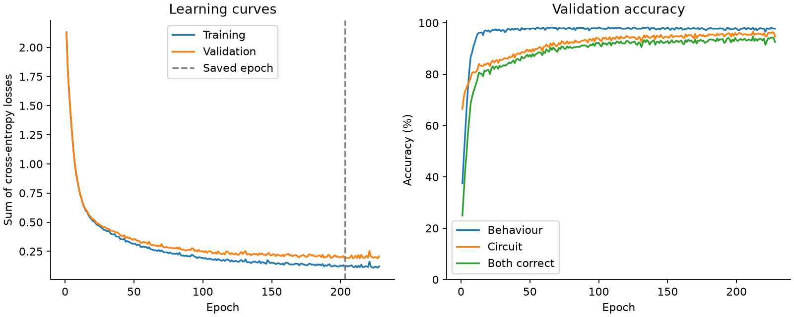
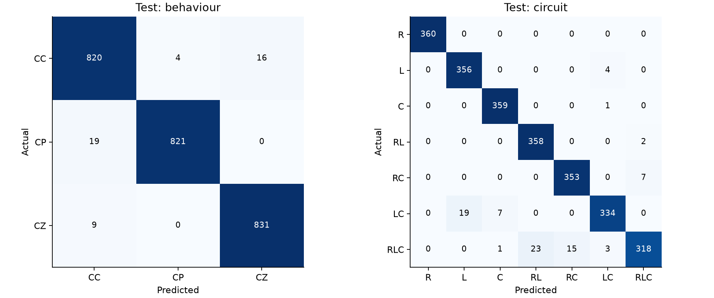

# Baseline test results

One shared MLP predicts behaviour and circuit type from 19 distinct measurements.
The test partition was evaluated after training and validation checkpoint selection.

| Partition | Rows | Behaviour accuracy | Circuit accuracy | Both correct |
|---|---:|---:|---:|---:|
| Train | 11,760 | 99.29% | 97.35% | 96.63% |
| Validation | 2,520 | 97.70% | 95.91% | 93.73% |
| Test | 2,520 | 98.10% | 96.75% | 94.92% |

## Test conditions

| Condition | Rows | Behaviour accuracy | Circuit accuracy | Both correct |
|---|---:|---:|---:|---:|
| Normal | 1,260 | 98.89% | 96.90% | 95.79% |
| Tough | 1,260 | 97.30% | 96.59% | 94.05% |

Both labels match on **2,392/2,520** test examples.
Macro-F1: behaviour **0.9810**, circuit **0.9671**.

## Behaviour classes on test

| Class | Precision | Recall | F1 | Support |
|---|---:|---:|---:|---:|
| CC | 0.9670 | 0.9762 | 0.9716 | 840 |
| CP | 0.9952 | 0.9774 | 0.9862 | 840 |
| CZ | 0.9811 | 0.9893 | 0.9852 | 840 |

## Circuit classes on test

| Class | Precision | Recall | F1 | Support |
|---|---:|---:|---:|---:|
| R | 1.0000 | 1.0000 | 1.0000 | 360 |
| L | 0.9493 | 0.9889 | 0.9687 | 360 |
| C | 0.9782 | 0.9972 | 0.9876 | 360 |
| RL | 0.9396 | 0.9944 | 0.9663 | 360 |
| RC | 0.9592 | 0.9806 | 0.9698 | 360 |
| LC | 0.9766 | 0.9278 | 0.9516 | 360 |
| RLC | 0.9725 | 0.8833 | 0.9258 | 360 |

## Training

- Architecture: 19 → 64 → 32, followed by separate 3-class and 7-class softmax heads.
- Trainable parameters: 3,690.
- Training/split seed: 42 / 42.
- Saved epoch: 203 of 228 completed epochs.
- Selection: Lowest validation sum of behaviour and circuit cross-entropy, min_delta applied.
- ReLU hidden layers; Adam; equally weighted behaviour and circuit cross-entropy.
- Learning rate 0.001; batch size 128; L2 coefficient 0.0001.
- Standardization is fitted on training rows only. No resampling, feature engineering or ensemble.
- History losses exclude the training-only L2 term, so training/validation curves are comparable.

## Interpretation and next experiments

This is a starting measurement, not an optimized classifier. Keep the split fixed and use
validation results for future feature and model choices. Do not tune against this test report.
Compare voltage/current/power sweep ratios or slopes, removal of redundant measurement groups,
and small network-size or training-setting changes. Compare other classifiers only after the
neural baseline is fixed. Repeat promising experiments with several training seeds.

The circuit head may confuse circuits with similar available measurements. The workbook has
aggregate distortion features, not full harmonic impedance or transient measurements. Higher
scores are not guaranteed from model size alone.

These are simulated labelled loads informed by real load-profile values. The workbook defines
CC/CP/CZ as dominant ZIP behaviour. Source keys are unique, but physical circuit IDs and the
generator are unavailable, so physical independence and real-appliance performance are not established.
Normal and tough test subsets come from the same two condition families used during training;
this is not a test on a completely unseen condition family.

Exact scores and confusion matrices: [metrics.json](metrics.json).
Every test prediction and class probability: [test_predictions.csv](test_predictions.csv).

## Provenance

- Workbook SHA-256: `73d838cb216aa2c758582435775ed45c379329382cd24783a25d3df57b6f5e0b`
- Split SHA-256: `1b45f13bfc5b839254d904631d738ce4f360c0cafce28972539413352ef5df70`
- Checkpoint SHA-256: `f283b5c11736e10093c4e17da3dd15e925caa908bdde47286ec4d3d2a215cbe3`
